# Auditoría y extensiones del análisis

**Fecha:** 2026-11-02. **Rama:** `mejoras/tda-avanzado`.

Revisa `reporte/trabajo_final.md` y `reporte/paper.typ` contra el código y los archivos
intermedios, y agrega experimentos nuevos. Se puede reproducir con los notebooks `22` a
`27`; los resultados numéricos están en `outputs/auditoria/`. Las secciones 8 a 10 son la
fuente de las correcciones del reporte, el paper y la presentación.

## Resumen

1. **Lo que se sostiene:** las ubicaciones de los huecos son correctas, el K=7 de CDMX
   es el óptimo exacto de su problema y las coberturas de 42,687 y 35,868 personas se
   reproducen. Los huecos grandes resisten perturbaciones fuertes.
2. **Lo que hay que corregir:**
   - El análisis final usa el Alpha **clásico**, no Laguerre.
   - El aumento de +66% que se atribuye a Laguerre no viene de los hospitales.
   - La cobertura se calculó con distancia euclidiana × 1.35, no con la red vial.
   - La prueba de robustez no puede fallar.
3. **Lo más importante:** las clínicas propuestas casi no cierran huecos. Se cierra 1 de
   46 en CDMX y 2 de 77 en EDOMEX. Su valor está en alcanzar personas, no en cambiar la
   topología.

## 1. Cifras: reporte contra código

| Tema | Reporte y paper | Lo que hay en el código y los datos | Evidencia |
|---|---|---|---|
| Complejo que alimenta el scoring y el MCLP | Weighted Alpha (Laguerre), 118 y 241 huecos | Alpha clásico, 71 y 209; el 100% de `huecos_censal` coincide con el clásico y 0% con Laguerre | `notebooks/10_cruce_censal.py:87`, `auditoria.json` |
| Huecos habitados, CDMX | 62 de 118; en §8.2, "118 habitados" | 62 de 71 clásicos; con Laguerre serían 109 de 118 | `auditoria.json` |
| Huecos habitados, EDOMEX | 180 de 241 | 99 de 209 clásicos; con Laguerre, 131 de 241. El 180 no se pudo reproducir | `auditoria.json` |
| Personas sin seguro en huecos habitados | ~88,000 + ~182,000 = ~270,000 | 112,895 + 216,747 = 329,642. Sin repetir AGEB, 322,954 | `huecos_censal_*.parquet` |
| Causa del +66% de Laguerre | Heterogeneidad de hospitales | Efecto de la escala: pesos iguales dan 116 y 240; pesos barajados, 115 y 240 en promedio | Sección 2 |
| Fórmula del radio | `k·√per_ocu`; la mayoría < 50 m; hospitales de 300 a 500 m | `50 + 30·√per_ocu`; mínimo 102 m, máximo 570 m | `lib/tda.py:31` |
| Tiempos y cobertura | Red peatonal; radio de 1,125 m | Euclidiana × 1.35 en todos los candidatos guardados (`modo: euclidiana`), radio efectivo de 833 m | `soluciones_mclp_red.pkl` |
| Clínicas en EDOMEX | "9 ubicables" | **8** clínicas (Norte 2, Poniente 3, ZMVM 3). El 9 es el número de huecos cubiertos. También aparece en la figura de LinkedIn | `clinicas_subregionales_EDOMEX.pkl` |
| Por qué Oriente queda fuera | Sin candidatos válidos al umbral de 15 min | Sus 6 clusters quedaron fuera del corte de 20 candidatos; el mejor tiene rango 22. Sus tres mayores clusters suman 10,160 personas | `auditoria.json` |
| Clusters de EDOMEX | 74 y 77 en §8.3; 69 y 72 en §9.4 | 74 clusters y 77 huecos; §9.4 quedó de una versión anterior | `clusters_EDOMEX.parquet` |
| Marginación de huecos persistentes | 0.29 en §9.3; 0.28 en §11.1 | Inconsistencia interna | `trabajo_final.md` |
| Justificación de K=7 | Punto antes de la caída sostenida | La mayor caída de la tabla está en K=8→9, así que el codo sugeriría K=8. K=7 es una decisión razonable, no un codo | `trabajo_final.md` §9.2 |

**Cómo se cuenta la población.** Un hueco recibe toda la población de cualquier AGEB que
toque un disco de radio `pers/2`. Si solo se cuenta la parte de cada AGEB dentro de ese
disco, quedan 7,416 personas en CDMX, no 112,895. El disco de `pers/2` tampoco es el vacío
real. Usando el disco vacío verdadero (radio = muerte, con su centro exacto) y repartiendo
la población de cada AGEB por área, salen **115,390 en CDMX y 210,153 en EDOMEX, en total
unas 325,500**. Una versión anterior de esta auditoría daba 116,996 y 225,224 porque usó el
baricentro como centro; el notebook 26 lo corrige. El orden de magnitud se sostiene, pero por
una razón distinta a la del reporte, y supone población uniforme dentro de cada AGEB.

**Medida del hueco.** El radio del disco vacío es la muerte, no la persistencia. En la
mediana, la muerte es 1.75 veces la persistencia en CDMX y 2.85 en EDOMEX. Por eso
"persistencia = tamaño real del vacío" es incorrecto, y la regla `d < pers` no equivale a
caer dentro del vacío. Además, un hueco muere cuando los discos se llenan, no cuando "una
clínica lo triangula".

**Comprobado y correcto:**

- Gudhi conserva los índices de los puntos, así que las ubicaciones son válidas.
- El centro calculado de cada hueco coincide con el disco vacío (error 0.0 m).
- La selección K=7 de CDMX es el óptimo exacto; se comprobó con las 77,520 combinaciones.
- 42 de 46 y 74 de 77 huecos prioritarios tienen un hueco de Laguerre a menos de 500 m,
  así que usar uno u otro complejo cambia poco las zonas señaladas.
- Quitar la asistencia social (SCIAN 623 y 624) casi no cambia el conteo: 67 huecos en
  CDMX y 191 en EDOMEX.

## 2. Laguerre: por qué sube el conteo

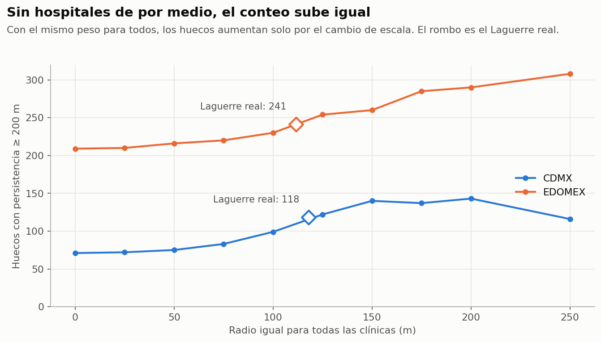

Con el mismo peso r² para todas las clínicas, la geometría es la del Alpha clásico. Los
pares de símplices son los mismos y solo se desplaza la filtración: α' = α − r². Pero la
persistencia se mide como √α'(muerte) − √α'(nacimiento), y esa diferencia crece al
acercarse a cero. Además, `ciclos_H1` recorta a 0 los nacimientos negativos.

| | Clásico | Pesos iguales | Pesos barajados (media de 10) | Laguerre real |
|---|---|---|---|---|
| CDMX | 71 | 116 | 115.1 | 118 |
| EDOMEX | 209 | 240 | 239.6 | 241 |

La ponderación sí cambia **cuáles** huecos aparecen: 36 de los 118 de CDMX no tienen
equivalente a 500 m con pesos iguales. Lo que no explica es **cuántos** hay.

## 3. ¿Las clínicas cierran los huecos?

`notebooks/23_cierre_real.py` agrega las clínicas a la nube de puntos, recalcula la
persistencia con el Alpha clásico y sigue cada hueco prioritario. La regla del reporte se
reprodujo exactamente, así que la diferencia viene de medir y no de los datos de partida.

| | CDMX (7 clínicas, 46 huecos) | EDOMEX (8 clínicas, 77 huecos) |
|---|---|---|
| Regla del reporte: cerrados, parciales, persistentes | 3, 4, 39 | 6, 2, 69 |
| **Medido: cerrados, modificados, intactos** | **1, 13, 32** | **2, 8, 67** |
| Modificados que quedan más chicos | 4 de 13 | 5 de 8 |
| Reducción de persistencia según el reporte | 14.9% | 16.5% |
| **Reducción medida** | **2.3%** | **7.4%** |
| Reducción con selección al azar (media; p5 a p95) | 5.5% (2.8 a 8.0) | 7.4% (5.0 a 9.5) |
| Clínica en el centro de los K huecos más persistentes | 16.7%, 0 cerrados | 10.3%, 1 cerrado |
| Huecos ≥ 200 m en toda la región, antes y después | 71 → 72 | 209 → 210 |

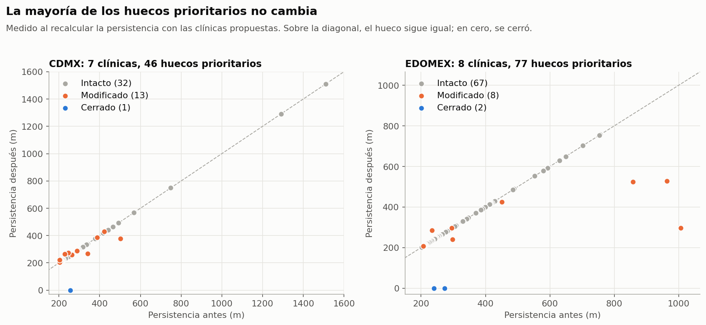

Tres lecturas:

- **Una clínica no cierra un hueco grande, lo parte.** Incluso en el centro exacto del
  vacío suele dejar fragmentos ≥ 200 m. Por eso el conteo global sube. Los huecos cerrados
  son todos pequeños (239 a 273 m), y los más grandes de CDMX (1,510 y 1,292 m) quedan
  intactos.
- **En persistencia, el MCLP no supera al azar.** En CDMX queda por debajo del percentil 5
  y en EDOMEX iguala la media.
- **En personas, sí gana en CDMX.** Alcanza a 42,687 personas sin seguro a menos de 833 m,
  contra una media de 22,403 al azar (p95: 31,343) y 15,419 con la colocación topológica.
  En EDOMEX, los 35,868 quedan dentro del rango del azar (media 25,707; p95 37,503): la
  restricción por zonas sacrifica cobertura a cambio de presencia geográfica.

La distancia media a la clínica más cercana dentro de los discos vacíos casi no cambia:
de 271 a 256 m en CDMX y de 359 a 346 m en EDOMEX.

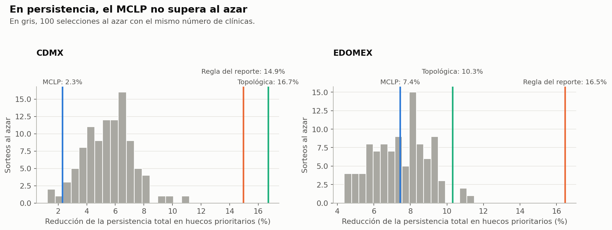

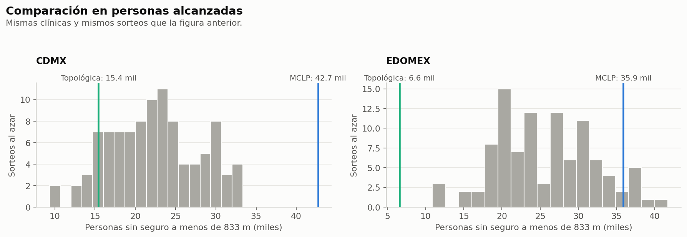

**Conclusión:** "validación topológica" no describe lo que hace el notebook 17. Las
clínicas se justifican por acceso de personas, no por cierre de huecos. Si el objetivo
fuera reducir vacíos, habría que optimizar otra cosa.

**Cómo se definió "modificado":** el par de símplices cambió y queda un hueco ≥ 200 m
centrado en el disco original. Ese hueco puede ser un fragmento o un vecino afectado, y por
eso puede ser más grande. "Cerrado" significa que no queda ninguno ≥ 200 m ahí, no que el
área quede bien cubierta.

## 4. Robustez real

La prueba del notebook 21 no puede fallar: un hueco con persistencia ≥ 600 m pasa por
definición los filtros de 100, 200 y 400 m. `notebooks/24_robustez_real.py` perturba los
**datos** y recalcula todo, con 40 réplicas por escenario.

| Huecos prioritarios que sobreviven | CDMX | EDOMEX |
|---|---|---|
| Quitando 10% de establecimientos | 87% | 84% |
| Quitando 30% | 67% | 62% |
| Ruido σ = 25 m | 84% | 88% |
| Ruido σ = 50 m | 73% | 79% |
| Ruido σ = 100 m | 59% | 65% |
| Ruido σ = 250 m | 29% | 42% |
| Ruido σ = 1,000 m (nulo) | 5% | 10% |

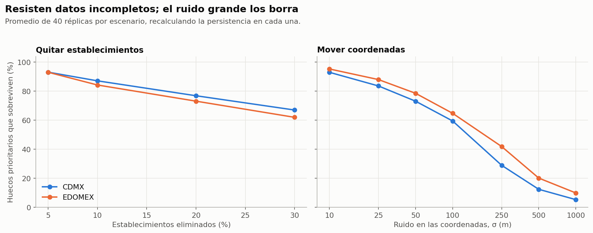

- **La persistencia sí predice estabilidad.** Con σ = 100 m sobrevive 93% de los huecos
  ≥ 400 m, contra 50% y 54% de los menores. Spearman: 0.84 y 0.81.
- **Muchos prioritarios son frágiles.** Con σ = 50 m, solo 22 de 46 en CDMX y 50 de 77 en
  EDOMEX sobreviven al menos 80% de las veces. La lista exacta de prioridades es menos
  firme que lo que sugiere el "100% de robustez".
- **El conteo no es evidencia por sí solo.** Al borrar la estructura fina con σ = 1,000 m
  quedan 57 huecos en CDMX (71 reales) y 361 en EDOMEX (209 reales). Pero casi nunca están
  en los mismos lugares: los huecos reales dependen de dónde están las clínicas, aunque
  su número se parezca al que produce la densidad sola.
- **Comparar contra el hueco nulo más grande es poco útil aquí.** Solo 3 huecos de CDMX y
  ninguno de EDOMEX superan el percentil 95 de la persistencia máxima nula, porque esa
  referencia la fija la periferia, sobre todo en EDOMEX.

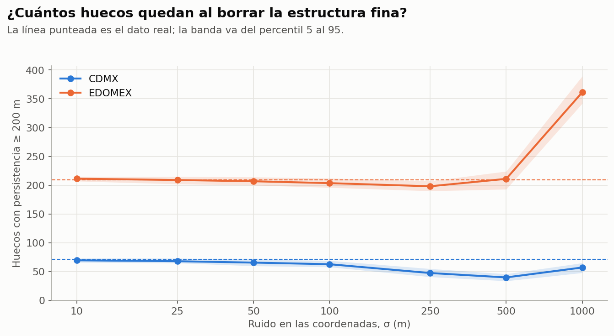

**Límites:** quitar puntos es una prueba fácil de pasar, y el radio de emparejamiento
(máx. de 100 m y media muerte) es una decisión mía. Con σ = 1,000 m, el ruido también lleva
puntos hacia zonas vacías, así que este nulo es exploratorio y no da valores p.

## 5. Otros sectores

`notebooks/25_otros_sectores.py` compara cinco sectores con el mismo pipeline.

| Sector | CDMX: puntos | Huecos | Con 10,149 puntos | EDOMEX: puntos | Huecos | Con 7,525 puntos |
|---|---|---|---|---|---|---|
| **Salud** | 21,585 | 71 | **73** | 30,787 | 209 | **185** |
| Educación | 10,406 | 79 | 79 | 19,681 | 233 | 218 |
| Comercio minorista | 198,738 | 71 | 81 | 393,087 | 283 | 217 |
| Alimentos y alojamiento | 56,992 | 77 | 80 | 93,730 | 257 | 202 |
| Servicios financieros | 10,149 | 83 | 83 | 7,525 | 141 | 141 |

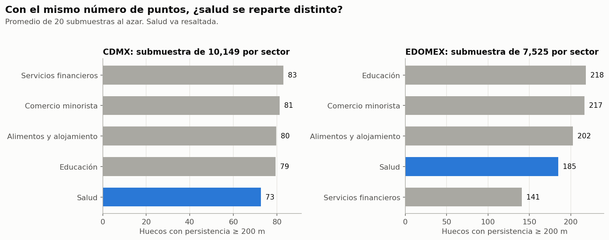

- **La salud no destaca por tener más huecos.** Con el mismo número de puntos es el sector
  con menos en CDMX y el segundo con menos en EDOMEX. Entre 31% y 61% de los huecos de
  salud coinciden con huecos de educación, comercio o alimentos.
- **Muchos huecos son de la forma de la ciudad.** CDMX tiene 71 huecos con 21,585 clínicas
  y también 71 con casi 200,000 comercios. Más puntos no los hacen desaparecer.
- **Muchos discos tienen poca actividad económica.** Solo 20 de 46 en CDMX y 25 de 77 en
  EDOMEX alcanzan 25% de la densidad típica de otros negocios. Esos discos reúnen 55% y 50%
  de las personas sin seguro contadas por el reporte. Son los candidatos más claros a "barrio
  sin clínica"; los demás pueden ser parques, industria o periferia.

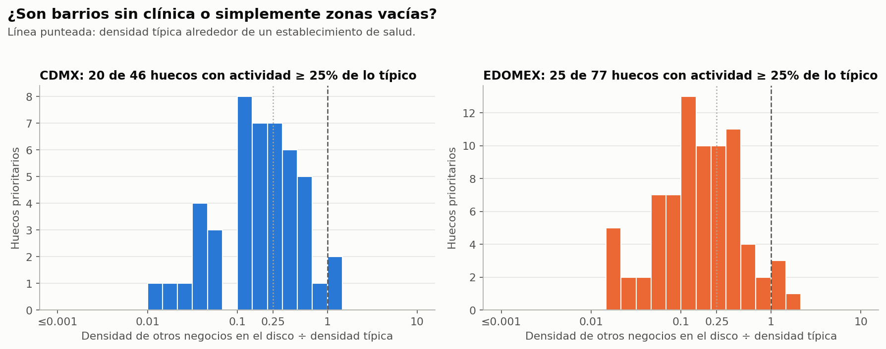

**Límites:** el umbral de 25% es arbitrario y la distribución es continua, no hay dos grupos
claros. La densidad típica se mide alrededor de establecimientos de salud, que suelen estar
en corredores comerciales, así que tiende a ser alta. Es una señal para revisar zonas, no una
clasificación. Tampoco se distingue la atención pública de la privada, y eso importa para
personas sin seguro.

## 6. Lo que no se resolvió

- **Red vial real:** `outputs/redes` y `Datos/OSM` están vacías, así que no se pudo calcular
  el MCLP sobre red real. Si se corre `15_mclp_red_real.py` así, cae a euclidiana.
- **Laguerre en todo el pipeline:** no se reconstruyeron el scoring ni el MCLP con esos
  huecos. Además, antes habría que definir bien qué significa su persistencia.
- **Origen de 88,000, 182,000 y 180:** no se encontró en los archivos actuales.
- **Oriente y Norte:** falta correr el MCLP con los clusters de cada zona como candidatos.

## 7. Correcciones sugeridas al reporte y al paper

Mario pidió aplicarlas el 2026-11-03 en la rama `mejoras/tda-avanzado`. En orden de importancia:

1. Decir que los huecos prioritarios salen del Alpha clásico, y presentar Laguerre como
   análisis de sensibilidad.
2. Retirar la explicación del +66% y la afirmación de "47 huecos invisibles".
3. Cambiar "validación topológica" por los valores medidos (1 de 46, 2 de 77; 2.3%, 7.4%).
4. Sustituir la prueba de robustez del notebook 21 por la de la sección 4.
5. Decir que la cobertura usa euclidiana × 1.35 con radio de 833 m.
6. Corregir a 8 clínicas en EDOMEX, la causa de Oriente, la fórmula del radio y las cifras
   de la sección 1. Lo de las 8 clínicas también afecta a `linkedin_3_resultados*.png`.

## 8. Otras cifras verificadas (`notebooks/27_verificaciones.py`)

| Tema | Reporte | Verificado |
|---|---|---|
| Huecos por umbral 100, 200, 400, 600 m (clásico, el que se usa) | 482/118/17/7 y 742/241/91/58 (esos son de Laguerre) | CDMX 286/71/16/6; EDOMEX 544/209/90/57 |
| Qué son las "clínicas" (52,372, SCIAN 62) | "clínicas" | Dentistas 16,890; otros ambulatorios 13,907; consultorios y clínicas médicas 12,473; asistencia social 8,217; hospitales 885. Decir "establecimientos de salud" |
| Tiempo a la clínica más cercana | "red vial real"; 10 huecos de CDMX con 20–35 min | Euclidiana × 1.35 desde el baricentro. CDMX: mediana 7.6 min, máximo 23.9, solo 4 de 62 > 15 min. EDOMEX: mediana 9.6, máximo 41.2, 16 de 99 > 15 min. Solo 3 + 3 huecos por ciudad tienen mapa con red OSM real (`mapas_accesibilidad_*`), como ilustración |
| Alcaldías nombradas como las más lejanas | Álvaro Obregón, etc. | No verificado; retirar |
| Error de la aproximación euclidiana | ±15% | Sin respaldo en el repositorio; retirar la cifra |
| Niveles de urgencia | Crítico 16/26, Alto 15/24; IM 0.29/0.37 | Crítico 16/26, Alto 16/24, Moderado 14/25, Bajo 16/24. IM de los críticos 0.33/0.44; 0.29/0.37 es la media global |
| Cluster 1 CDMX | 7,525 personas, más de 12 min | 7,525, 2 huecos, tiempo máximo 10.2 min, 31.9% |
| Cluster 5 EDOMEX | 23,869, 33.7% | 23,869, 3 huecos, 33.0%, tiempo máximo 13.8 min |
| Solución EDOMEX por zona | K=3 en cada zona | Norte 2 (solo tiene 2 candidatos), Poniente 3, ZMVM 3, Oriente 0 = 8. Frente al global K=5 son 3 clínicas más, no 7 |
| Función objetivo | score × personas en todo | Solo en CDMX K=5 y 7 (notebook 15). El subregional de EDOMEX y la curva K=5→10 usan solo personas (notebooks 17 y 19), aunque el título de la figura diga otra cosa |
| Curva de K en CDMX | 33.0, 38.6, 44.0, 49.1, 53.1, 56.1% | Corresponde a solo personas. Con score × personas: 32.0, 37.9, 44.0, 48.0, 53.1, 56.1%. K=7 da la misma selección con ambos |
| Núcleo estable C1, C2, C5, C7, C8 | Presente en toda la curva | Cierto con score × personas; con solo personas el núcleo es C1, C2, C5, C16, C19. La presentación además decía otra fase 1 (C1–C5–C7–C8) |
| Cuarto eje: 11 y 38 huecos suben; 9 de 10 estables | Efecto de agregar marginación | No se reproduce: la comparación 40/40/20 contra 25/25/25/25 mezcla pesos y da 25 y 45 huecos, top 10 comunes 9 y 5. Con 3 ejes iguales, 25 y 43, top 10 comunes 7 y 6. `20_indice_marginacion.py` es además circular: su score "original" ya incluye marginación |
| Cuarto eje: cambia quién recibe inversión | Sí | CDMX K=7: cambian 2 de 7 clínicas (C16 y C19 en vez de C3 y C17), 42,687 contra 39,974 personas, IM cubiertos 0.346 contra 0.317. EDOMEX K=8 global: no cambia ninguna. El subregional no usa el score. El filtro sí amplía de 39 a 46 y de 72 a 77 huecos. El IM incluye % sin seguro (Spearman 0.55 y 0.75 con esa variable), así que en parte repite ese eje |
| 0.35 contra 0.29 | "Por el cuarto eje" | Es descriptivo; la prueba es la fila anterior |
| Figuras `matriz_riesgo_*` e `impacto_censal_*` | Se presentan como distintas | Son archivos idénticos |
| Figura `laguerre_comparacion.png` | | Sus anotaciones dicen "−−47 huecos (−66% absorbidos)" y su título pregunta cuántos desaparecen, cuando el conteo sube. Sustituir por `auditoria_laguerre_artefacto.png` |
| Figuras `bifiltracion_*` en la diapositiva de Laguerre | "Huecos ponderados" | Salen del Alpha clásico (notebook 09); su "densidad" es solo de salud. No son Laguerre |
| `validacion_*`, `robustez_conteo/mapa/persistencia_*` | Validación y robustez | Reflejan la regla de distancia y el filtro que no puede fallar. Sustituir por `cierre_real_*` y `robustez_real_*` |
| Validación OSM de `16_resultados_fase3.py` (tiempos de 63 y 58 min) | No se reporta | Solución K=1 anterior, valores escritos a mano y red limitada a 2 km alrededor del hueco. No sirve como evidencia en ningún sentido |

**La red importa.** Con solo consultorios médicos y hospitales hay 61 huecos en CDMX y 182 en
EDOMEX; con solo públicos, 43 y 155. De los prioritarios, solo 19 de 46 y 34 de 77 tienen un
hueco de la red médica dentro de su disco, y 7 y 19 de la red pública. Las prioridades dependen
mucho de contar o no a dentistas y asistencia social.

## 9. Modelo revisado (`notebooks/26_modelo_revisado.py`)

Los criterios se fijaron antes de correr y están al inicio del notebook. Después de ver los
primeros resultados se agregó el análisis por tipo de red y el cálculo exacto de población;
además se corrigió el filtro de red pública, que al principio omitía los códigos 621114 y 621116.

**Definición única de personas.** `PSINDER` se reparte uniforme por AGEB en una rejilla de 100 m
y cada celda se cuenta una vez (difiere menos de 1% del cálculo exacto).

- **Vacío alcanzado:** personas sin seguro dentro de los discos prioritarios y a ≤ 833 m.
- **Acceso nuevo:** personas sin seguro que hoy están a > 833 m y quedarían a ≤ 833 m.

| Modelo | K | Conteo del reporte | Vacío alcanzado | Azar p95 | Con ruido σ=50 m | Acceso nuevo |
|---|---|---|---|---|---|---|
| CDMX Reporte | 7 | 42,687 | 26,281 | 18,363 | 20,807 | 319 |
| CDMX Personas | 7 | | **28,418** | 18,363 | 23,668 | 5 |
| CDMX Ponderado | 7 | | 27,650 | 18,363 | 22,748 | 0 |
| CDMX Sin topología | 7 | | 0 | | 0 | **4,346** |
| EDOMEX Reporte | 8 | 35,868 | 17,082 | 18,674 | 15,221 | 2,248 |
| EDOMEX Personas | 8 | | **30,033** | 18,674 | 26,517 | 0 |
| EDOMEX Ponderado | 8 | | 28,999 | 18,674 | 28,025 | 1,553 |
| EDOMEX Sin topología | 8 | | 2,938 | | 2,900 | **12,124** |
| EDOMEX Personas, sin zonas | 12 | | 41,469 | 26,429 | 34,470 | 0 |
| EDOMEX Personas, 3 por zona | 12 | | **31,413** | 21,198 | 27,055 | 2,064 |
| EDOMEX Ponderado, 3 por zona | 12 | | 28,625 | 21,198 | 24,896 | 1,625 |

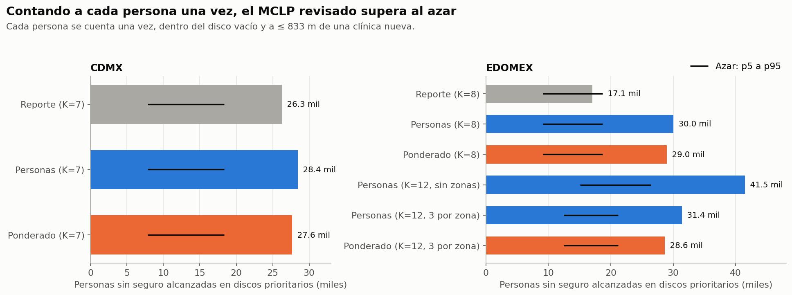

**Respuestas:**

1. **¿Supera al azar?** Sí, pero "Personas" optimiza esa medida, así que es un mínimo exigible. La
   solución del reporte supera al azar en CDMX y no en EDOMEX.
2. **¿Los pesos de robustez y actividad dan prioridades más firmes? No hay evidencia.** Con ruido
   nuevo, Ponderado menos Personas da −920 en CDMX (intervalo −1,458 a 32), +1,508 en EDOMEX K=8
   (−1,980 a 4,797) y −2,160 en 3 por zona (−5,341 a 1,748). No se cumple el criterio, así que se
   recomienda "Personas".
3. **¿Oriente tiene solución? Sí.** Sus 3 clínicas alcanzan 4,911 de 10,413 personas en sus discos,
   más que las de Norte (4,864 de 15,418). No hacen falta umbrales extendidos ni clínicas móviles
   para ubicarlas: el problema era el corte de 20 candidatos.
4. **Equidad.** Repartir 3 por zona cuesta 10,056 personas (41,469 contra 31,413).

**Resultado principal: los huecos no son donde la gente está lejos.** Solo 784 de 91,632 personas
(0.9%) en discos de CDMX y 8,900 de 179,612 (5.0%) en EDOMEX están a más de 833 m de cualquier
establecimiento. Casi todos los discos son más chicos que ese radio. Con el mismo K, buscar
directamente a quienes están lejos da mucho más acceso nuevo:

| Oferta que cuenta | Personas lejos (región) | En discos prioritarios | Reporte | Personas | Sin topología |
|---|---|---|---|---|---|
| CDMX, todos los establecimientos | 9,980 (0.4%) | 0.9% | 319 | 5 | 4,346 |
| CDMX, médicos y hospitales | 67,689 (2.7%) | 8.9% | 1,776 | 3,607 | 17,139 |
| CDMX, solo públicos | 505,903 (20.4%) | 41.8% | 25,028 | 27,966 | 69,145 |
| EDOMEX, todos | 104,597 (2.2%) | 5.0% | 2,248 | 0 | 12,124 |
| EDOMEX, médicos y hospitales | 372,295 (7.7%) | 17.8% | 6,362 | 4,926 | 29,338 |
| EDOMEX, solo públicos | 1,667,995 (34.6%) | 49.9% | 16,202 | 19,099 | 96,448 |

(K=7 en CDMX y K=8 en EDOMEX.)

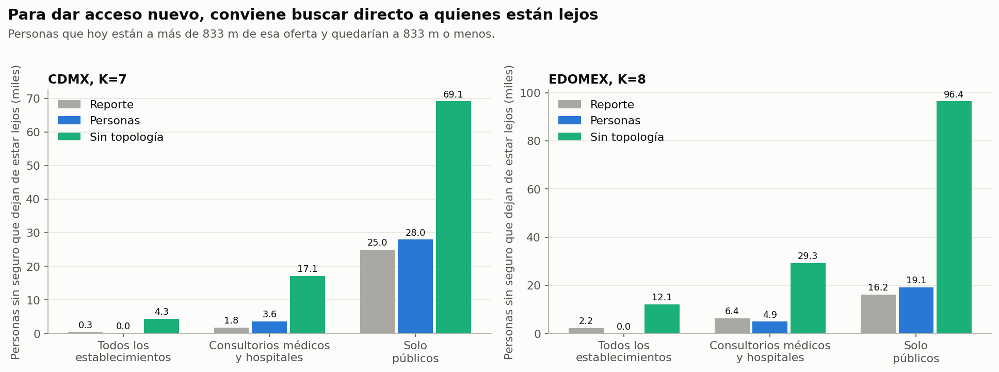

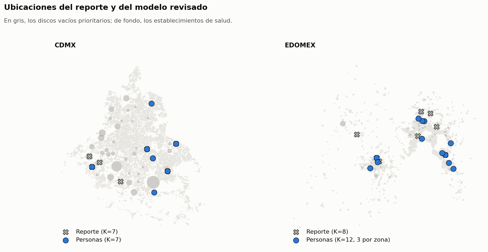

**Límites:**

- Línea recta × 1.35, no red vial.
- "Sin topología" usa un método voraz, así que su valor es un mínimo de lo que se puede lograr.
- Población uniforme dentro de cada AGEB y solo AGEB urbanas: la población rural no está contada.
- `PSINDER` es falta de afiliación, no de atención. La red pública incluye IMSS e ISSSTE, que atienden
  sobre todo a sus afiliados, y DENUE no indica capacidad.
- Estos modelos no prueban que una clínica en esos puntos mejore la salud de nadie.

## 10. Conclusión para el reporte

La persistencia homológica describe bien la **forma** de la red y encuentra vacíos relativos dentro de
la ciudad, y los grandes resisten perturbaciones. No basta para decidir dónde dar **acceso nuevo**: para
eso, medir directamente a quién le queda lejos la oferta es más simple. Con las redes médica y pública
rinde de 2.5 a 6 veces más que los modelos basados en huecos, y mucho más si cuentan todos los
establecimientos. La topología puede complementar ese análisis, pero aquí no se demostró que lo mejore.

## 11. Red pública (`notebooks/28_red_publica.py`)

Todo el análisis se repite solo con la red pública: consultorios (6211) y hospitales (622) del sector
público según DENUE, de ambos estados. La *variante abierta* quita por nombre las unidades de
seguridad social (IMSS, ISSSTE, ISSEMYM, PEMEX, SEDENA y SEMAR) y conserva IMSS-Bienestar. Los criterios
están en la cabecera del notebook y se fijaron antes de correr.

**Quién está lejos** (más de 833 m, unos 15 min a pie):

| | Establecimientos | Lejos | Más de 30 min |
|---|---|---|---|
| CDMX, pública | 554 | 505,903 (20.4%) | 1.2% |
| CDMX, abierta | 482 | 609,366 (24.6%) | 1.5% |
| EDOMEX, pública | 1,099 | 1,667,995 (34.6%) | 5.6% |
| EDOMEX, abierta | 952 | 1,838,281 (38.1%) | 6.3% |

**La topología como descripción:**

| | Huecos ≥ 200 m (nulo) | Persistencia total contra p95 del nulo | Captura | Enriquecimiento | Spearman |
|---|---|---|---|---|---|
| CDMX, pública | 43 (41) | 21,455 contra 20,966 m ✔ | 53% | 1.67 ✔ | 0.67 |
| CDMX, abierta | 39 (39) | 18,821 contra 19,592 m ✘ | 49% | 1.53 | 0.66 |
| EDOMEX, pública | 155 (95) | 121,422 contra 83,022 m ✔ | 52% | 1.43 ✘ | 0.22 |
| EDOMEX, abierta | 148 (88) | 119,294 contra 76,673 m ✔ | 51% | 1.42 ✘ | 0.11 |

- El nulo son 200 submuestras al azar de la red SCIAN 62 completa, del mismo tamaño que la red pública.
- La captura es la parte de las personas lejos que vive dentro de un disco vacío.
- El enriquecimiento es cuántas veces más común es estar lejos dentro de los discos que en toda la
  región.
- Spearman es la correlación entre la persistencia de cada hueco y las personas lejos dentro de su disco.

**Lectura:**

- EDOMEX tiene huecos propios claros. En CDMX el exceso es mínimo y desaparece con la variante abierta.
- Los huecos coinciden con la gente lejos solo en CDMX, y apenas: cumple el criterio (captura ≥ 50% y
  enriquecimiento ≥ 1.5) con la red pública, pero no con la abierta.
- Casi la mitad de las personas lejos vive dentro de la envolvente de la red pero fuera de cualquier
  disco. Son zonas ralas que no forman un ciclo.
- Fuera de la envolvente vive menos del 3%.
- En EDOMEX los discos son enormes (radio mediano de 2.7 km contra 1.3 km en CDMX) y abarcan mucho
  terreno sin gente.

**Cobertura medida directo.** Voraz que maximiza las personas lejos que pasan a ≤ 833 m:

| K = 10 | Candidatos libres (exacto) | Solo centros de huecos | Azar p95 | Con K = 30: libres y huecos |
|---|---|---|---|---|
| CDMX, pública | 91,263 (91,263) | 70,015 (77%) | 22,405 | 194,811 y 108,792 |
| CDMX, abierta | 100,605 (100,605) | 62,758 (62%) | 26,540 | 221,080 y 103,275 |
| EDOMEX, pública | 117,891 (117,891) | 92,593 (79%) | 19,351 | 280,907 y 169,584 |
| EDOMEX, abierta | 125,737 (127,807) | 100,161 (80%) | 21,152 | 301,614 y 171,526 |

- Los candidatos libres son centros de una rejilla de 500 m con gente. El exacto es el MCLP con los 400
  candidatos de mayor ganancia individual.
- El voraz iguala al exacto en tres de cuatro casos y queda 1.6% abajo en el cuarto.
- Los centros de huecos no alcanzan el 90% fijado como criterio para servir de candidatos, y la brecha
  crece con K.
- Aun así, 7 de los 10 sitios libres caen dentro de algún disco vacío: la topología apunta a la zona,
  pero no al punto.

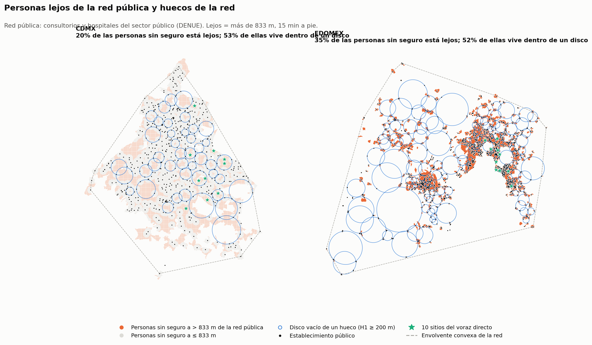

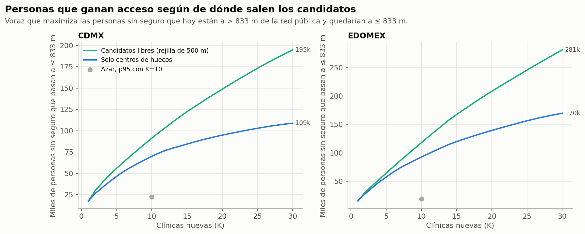

**Conclusión.** El MCLP sigue siendo un modelo pobre del problema: todo o nada a 833 m, sin capacidad y
en línea recta. Por eso el proyecto cambia de enfoque, del hueco al **acceso medido**. La topología se
aplica ahora sobre la superficie de acceso, no sobre los puntos de las clínicas. El plan está en
`PLAN_ACCESO.md`.
