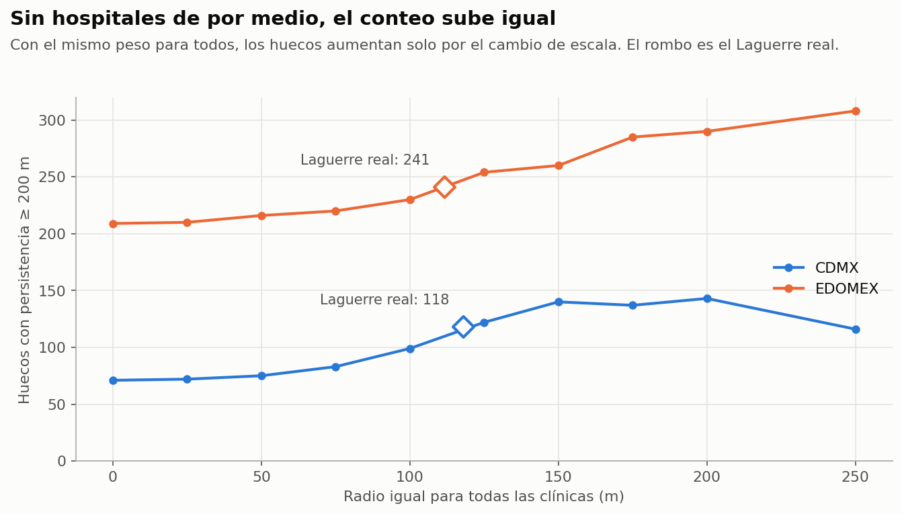
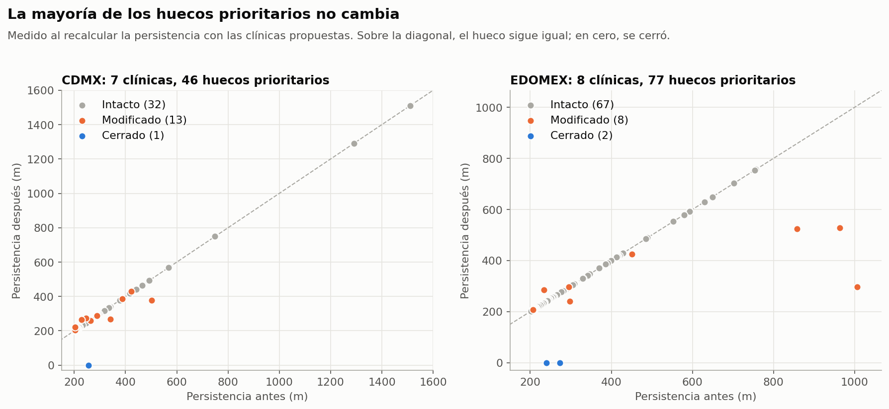
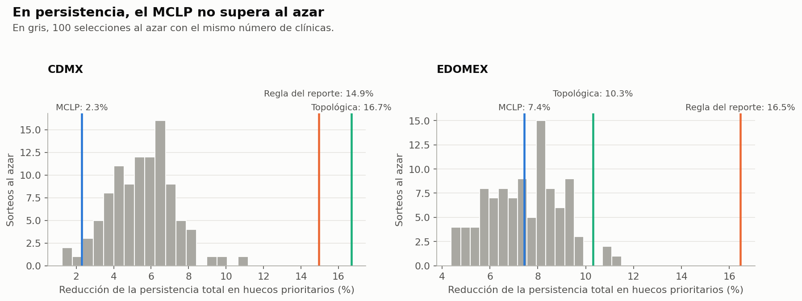
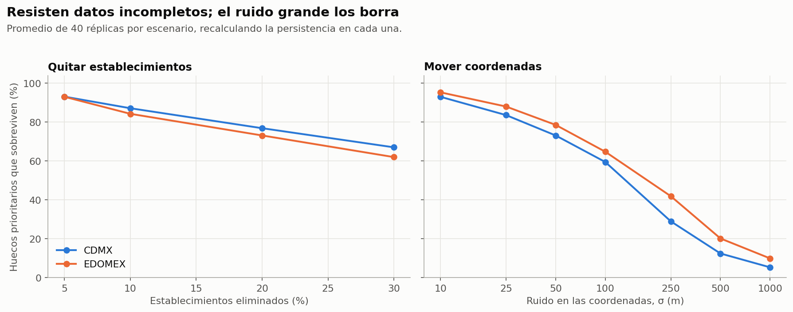
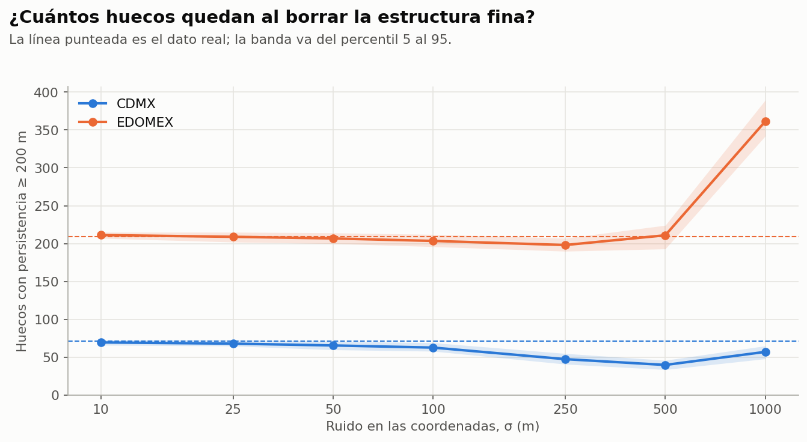
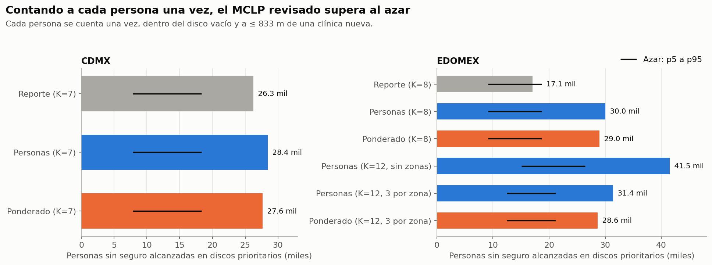
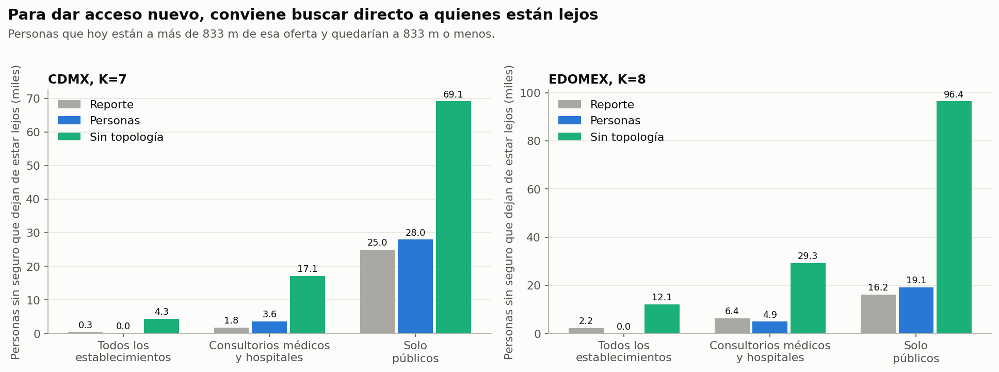
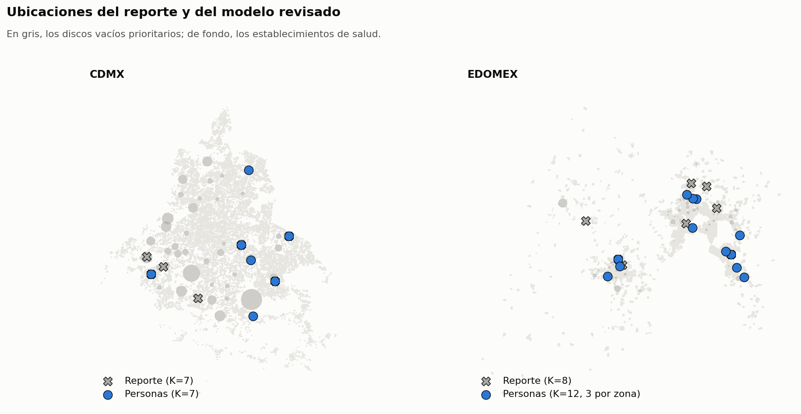
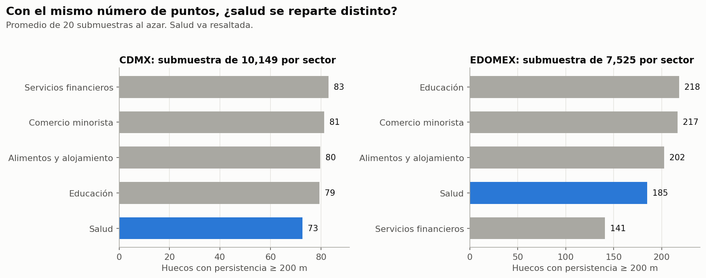

# Persistencia Homológica para Detectar y Resolver Desiertos de Salud
## Ciudad de México y Estado de México

**Autores:** Mario Carlos Gaitán · Rodrigo Jiménez · Andrés Kiewek · Juan Pablo Moral · Luis Alan Morales  
**Datos:** DENUE 2023 (INEGI) · Censo de Población y Vivienda 2020 (INEGI) · OpenStreetMap  
**Región:** Zona Metropolitana del Valle de México

---

## 1. El Problema: Desiertos de Salud que los Mapas Tradicionales No Ven

Ciudad de México tiene 21,585 establecimientos de salud registrados. Estado de México tiene 30,787. A primera vista, no parece haber escasez. Sin embargo, el total no dice cómo se reparten: puede haber zonas rodeadas de establecimientos pero con un interior sin ninguno.

Las métricas tradicionales (densidad por km², radio de cobertura de 500 m, número de establecimientos por municipio) no describen la **forma** de esa distribución. Una zona completamente rodeada de infraestructura médica pero con un interior vacío puede verse bien en un mapa de densidad.

A ese tipo de vacío lo llamamos **desierto de salud estructural**: un vacío relativo dentro de la ciudad, no necesariamente una zona donde la gente esté lejos de todo. El método para detectarlo viene de una rama de las matemáticas llamada Análisis Topológico de Datos.

**Pregunta central:** ¿Dónde están esos vacíos en CDMX y EDOMEX, cuánta población sin seguro hay dentro, cómo priorizamos las inversiones y qué tanto cambian el acceso las nuevas clínicas propuestas?

---

## 2. Los Datos: Estableciendo la Base

### 2.1 Establecimientos de Salud — DENUE 2023

El Directorio Estadístico Nacional de Unidades Económicas (DENUE) del INEGI registra los negocios y servicios activos por código de actividad económica. Usamos el sector **SCIAN 62** (servicios de salud y asistencia social). Son 52,372 **establecimientos de salud**, no todos clínicas:

| Región | Establecimientos SCIAN 62 |
|--------|--------------------------|
| CDMX   | **21,585**               |
| EDOMEX | **30,787**               |

Composición del total (ambas regiones):

| Tipo | Establecimientos |
|------|------------------|
| Consultorios dentales | 16,890 |
| Otros servicios ambulatorios | 13,907 |
| Consultorios y clínicas médicas | 12,473 |
| Asistencia social | 8,217 |
| Hospitales | 885 |

Cada establecimiento tiene coordenadas geográficas y una variable de tamaño (`PER_OCU`: personas ocupadas). El preprocesamiento convirtió los rangos de texto ("11 a 30 personas") a valores numéricos. DENUE no indica la capacidad de atención, así que `PER_OCU` es solo una aproximación. El análisis principal no la usa; interviene en el análisis de sensibilidad con pesos de la §4.

> **Figuras:** `outputs/figuras/eda_CDMX.png` y `outputs/figuras/eda_EDOMEX.png` — Distribución del tamaño de los establecimientos. La gran mayoría son micro-establecimientos (0–5 personas).

### 2.2 Datos Demográficos — Censo de Población y Vivienda 2020

Para saber a quién afectan los vacíos, cruzamos su geografía con el Censo 2020 a nivel de **AGEB urbana** (Área Geoestadística Básica), la unidad mínima del Censo equivalente a unas pocas manzanas.

Las variables que usamos:

| Variable censal | Qué mide | Por qué la usamos |
|----------------|----------|-------------------|
| `PSINDER` | Personas sin derechohabiencia (sin seguro médico) | Identifica a quienes no tienen afiliación a servicios de salud |
| `GRAPROES` | Grado promedio de escolaridad | Componente del índice de marginación |
| `P60YMAS` | Población de 60 años y más | Mayor vulnerabilidad en salud |
| `POBTOT` | Población total | Para calcular porcentajes |

`PSINDER` mide falta de afiliación, no falta de atención. Una persona sin seguro puede acudir a servicios privados o a los que atienden sin afiliación; una afiliada puede no recibir atención donde vive. Es la mejor aproximación disponible, pero no es una medida directa de acceso. Solo se cuentan AGEB urbanas: la población rural no está incluida.

---

## 3. Detectando los Vacíos: Análisis Topológico de Datos

### 3.1 ¿Qué es un Hueco Topológico?

La topología estudia la **forma** de los espacios, no sus medidas exactas. En este caso, nos interesa la forma de la nube de establecimientos: ¿forma anillos con vacíos adentro, o es una nube uniforme?

Un **hueco H₁** (primer grupo de homología) es un ciclo cerrado de establecimientos que rodea un espacio vacío. No importa qué tan irregular sea el contorno: si hay un vacío rodeado por todos lados, la persistencia homológica lo detecta.

La **persistencia** mide qué tan duradero es ese hueco al ir creciendo los discos. Si desaparece casi de inmediato, es ruido o una brecha mínima entre establecimientos vecinos. Si sobrevive a un intervalo largo de radios, es una estructura estable.

### 3.2 Alpha Complex y Persistencia Homológica

El método construye un **Alpha Complex** sobre los puntos (establecimientos) en el plano. Se hace crecer un disco de radio $\alpha$ alrededor de cada punto. Cuando dos discos se tocan, se forma una arista. Cuando tres se tocan, se forma un triángulo (2-símplex). El proceso revela progresivamente la topología de la nube de puntos.

Un hueco "nace" al radio $r_{\text{nac}}$, cuando los discos cierran un ciclo alrededor de un vacío, y "muere" al radio $r_{\text{mue}}$, cuando los discos crecidos llenan ese vacío. La **persistencia** es la diferencia:
$$\text{persistencia} = \text{radio\_muerte} - \text{radio\_nacimiento}$$

Persistencia y tamaño del vacío no son lo mismo. **El radio del disco vacío que rodea el ciclo es la muerte**, no la persistencia. En la mediana, la muerte es 1.75 veces la persistencia en CDMX y 2.85 veces en EDOMEX. Por eso la persistencia sirve para ordenar huecos por estabilidad, pero no mide cuántos metros hay hasta el establecimiento más cercano.

> **Figuras:** `outputs/figuras/persistencia_CDMX.png` y `outputs/figuras/persistencia_EDOMEX.png` — Diagramas de persistencia H₀, H₁ y H₂. Los puntos alejados de la diagonal son huecos de mayor persistencia.

### 3.3 ¿Por Qué Elegimos min_persistencia = 200 m?

Probamos cuatro umbrales con el Alpha Complex clásico, que es el que alimenta todo el análisis posterior:

| Umbral min_persistencia | Huecos CDMX | Huecos EDOMEX | Interpretación |
|------------------------|-------------|---------------|----------------|
| 100 m | 286 | 544 | Incluye micro-brechas entre establecimientos adyacentes |
| **200 m** | **71** | **209** | Umbral elegido |
| 400 m | 16 | 90 | Solo los más persistentes |
| 600 m | 6 | 57 | Muy pocos huecos |

La elección de 200 m es una decisión de criterio: a 100 m el conteo se multiplica por cuatro en CDMX con huecos que son brechas pequeñas, y a 400 m quedan muy pocos para priorizar. No hay un punto óptimo demostrado.

El umbral se aplica a la persistencia, no al radio del vacío. Con persistencia de 200 m o más, el radio del disco vacío suele ser mayor (la muerte es mediana 1.75 y 2.85 veces la persistencia, ver §3.2).

La estabilidad de los huecos se evaluó perturbando los datos y recalculando todo; los resultados están en la §10.2.

> **Figura:** `outputs/figuras/robustez_persistencia_vs_umbrales.png` — Relación entre la persistencia de cada hueco y cuántos umbrales lo detectan.

### 3.4 Los Huecos Encontrados y su Geolocalización

Con el umbral de 200 m aplicado sobre el Alpha Complex clásico, encontramos:

- **CDMX:** 71 huecos topológicos
- **EDOMEX:** 209 huecos topológicos

Cada hueco tiene un **centro** (coordenadas del centro del disco vacío, verificado contra el cálculo directo con error de 0.0 m) y una persistencia en metros.

**Nota sobre la comparación entre ciudades.** El conteo crudo 71 vs 209 no debe leerse como "EDOMEX tiene cobertura tres veces peor". EDOMEX cubre un territorio aproximadamente 3–4 veces mayor que CDMX (125 municipios frente a 16 alcaldías), incluye zonas periurbanas y semi-rurales y sus huecos más grandes en el dato bruto alcanzan hasta 11,808 m de persistencia, vacíos de escala rural. Por eso el análisis **no compara los 71 y 209 huecos directamente como indicadores de urgencia relativa**. A partir de §5, cada ciudad se analiza por separado: los huecos se filtran a zonas habitadas, los scores usan percentiles dentro de cada ciudad y el MCLP optimiza independientemente. Los huecos que llegan al scoring tienen persistencia máxima de 1,006 m en EDOMEX frente a 1,510 m en CDMX.

> **Figuras interactivas:** `outputs/figuras/huecos_CDMX.html` y `outputs/figuras/huecos_EDOMEX.html` — Mapas interactivos donde cada círculo representa un hueco topológico. El radio del círculo es proporcional a su persistencia.

### 3.5 Clasificación de los Huecos por Persistencia y Tiempo de Acceso

Analizamos dos dimensiones por separado.

**Por persistencia** (no es el tamaño del vacío, ver §3.2):

| Categoría | Persistencia | Lectura |
|-----------|-------------|---------|
| Micro | < 200 m | Bajo el umbral de análisis |
| Mediano | 200–400 m | Persistencia moderada |
| Grande | 400–700 m | Persistencia alta |
| Severo | > 700 m | Persistencia muy alta |

**Por tiempo de acceso al establecimiento más cercano** (estimado con distancia euclidiana × 1.35, ver §6): en los huecos habitados de CDMX la mediana es 7.6 min y el máximo 23.9 min; en EDOMEX, la mediana es 9.6 min y el máximo 41.2 min.

> **Figuras:** `outputs/figuras/comparativa_tamano.png` — Top 10 huecos por persistencia en cada ciudad. `outputs/figuras/comparativa_distancia.png` — Top 10 huecos con mayor tiempo estimado al establecimiento más cercano.

---

## 4. Análisis de Sensibilidad: Weighted Alpha Complex (Laguerre)

### 4.1 La Pregunta

El Alpha Complex clásico trata todos los establecimientos como puntos iguales. Un consultorio de 1 persona y un hospital de 300 empleados no tienen la misma capacidad. El Weighted Alpha Complex (diagramas de Laguerre) asigna un peso a cada establecimiento según su tamaño. Probamos si ponderar cambia los resultados.

**El análisis principal del reporte usa el Alpha clásico (71 y 209 huecos).** Laguerre se presenta como sensibilidad y no alimenta el scoring ni el MCLP.

### 4.2 La Ponderación

El radio de cada establecimiento es:

$$r_i = 50 + 30 \cdot \sqrt{\text{per\_ocu}_i}$$

Los radios van de 102 m (mínimo) a 570 m (máximo). Son valores sustanciales para todos los establecimientos, no solo para hospitales: el radio mínimo ya es de 102 m.

### 4.3 Resultado: el Conteo Sube, Pero No por los Hospitales

| | Clásico | Pesos iguales | Pesos barajados (media de 10) | Laguerre real |
|---|---|---|---|---|
| CDMX | 71 | 116 | 115.1 | 118 |
| EDOMEX | 209 | 240 | 239.6 | 241 |

Con Laguerre el conteo sube 66% en CDMX (71 a 118) y 15% en EDOMEX (209 a 241). Ese aumento es sobre todo **efecto de la escala**: dando el mismo peso a todos los establecimientos, sin ninguna heterogeneidad, ya salen 116 y 240 huecos. Con pesos barajados al azar salen 115 y 240 en promedio. La diferencia se debe a cómo se mide la persistencia: con pesos iguales los pares de símplices son los mismos que en el clásico y solo se desplaza la filtración ($\alpha' = \alpha - r^2$), pero la persistencia se calcula como $\sqrt{\alpha'_{\text{muerte}}} - \sqrt{\alpha'_{\text{nacimiento}}}$, y esa diferencia crece al acercarse a cero. Además, los nacimientos negativos se recortan a 0.

La ponderación sí cambia **cuáles** huecos aparecen: 36 de los 118 huecos de Laguerre en CDMX no tienen equivalente a 500 m con pesos iguales. Pero no explica **cuántos** hay.

Para las zonas señaladas el efecto es pequeño: 42 de los 46 huecos prioritarios de CDMX y 74 de los 77 de EDOMEX tienen un hueco de Laguerre a menos de 500 m. Usar uno u otro complejo cambia poco dónde miramos.

> **Figuras interactivas:** `outputs/figuras/huecos_laguerre_CDMX.html` y `outputs/figuras/huecos_laguerre_EDOMEX.html` — Mapas interactivos con los huecos de Laguerre.

No se reconstruyeron el scoring ni el MCLP con huecos de Laguerre; antes habría que definir bien qué significa su persistencia.

---

## 5. ¿A Quién Afectan? Los Datos del Censo 2020

### 5.1 Cruces con Datos Demográficos

Para que los huecos topológicos tengan relevancia de política pública, necesitamos saber quién vive dentro de ellos. Cruzamos los 71 huecos de CDMX y los 209 de EDOMEX con las AGEB del Censo 2020.

De los 71 huecos de CDMX, **62 son habitados** (los restantes caen en zonas industriales, de reserva o parques). De los 209 de EDOMEX, **99 son habitados**. Este filtro descarta los huecos de persistencia extrema de EDOMEX, que corresponden a vacíos periurbanos o rurales sin AGEB urbana asignada.

### 5.2 Personas Sin Seguro Médico

**Definición única de población.** Se toma el disco vacío real de cada hueco (radio igual a la muerte, centro exacto) y la población sin seguro de cada AGEB se reparte por área, de modo que cada persona se cuenta una vez. Supone población uniforme dentro de cada AGEB.

| Región | Huecos habitados | Personas sin seguro en discos vacíos |
|--------|------------------|--------------------------------------|
| CDMX | 62 | 115,390 |
| EDOMEX | 99 | 210,153 |
| **Total** | **161** | **~325,500** |

Nota: asignar a cada hueco la población completa de cualquier AGEB que toque un disco de radio igual a la mitad de su persistencia da 329,642 personas (112,895 en CDMX y 216,747 en EDOMEX), pero cuenta repetidamente a quienes caen en varios huecos y el disco usado no es el vacío real. Cifras de versiones anteriores del reporte no se pudieron reproducir y se retiraron.

> **Figuras:** `outputs/figuras/matriz_riesgo_CDMX.png` y `outputs/figuras/matriz_riesgo_EDOMEX.png` — Scatter de persistencia vs % de población sin seguro por hueco. Los huecos en la esquina superior derecha tienen alta persistencia y alta proporción de población sin seguro.

> **Figuras interactivas:** `outputs/figuras/huecos_censal_CDMX.html` y `outputs/figuras/huecos_censal_EDOMEX.html` — Mapa interactivo donde cada hueco muestra su población sin seguro, grado promedio de escolaridad y proporción de adultos mayores.

### 5.3 Los Huecos con Mayor Impacto

En CDMX, el Cluster 1 agrupa 2 huecos con 7,525 personas sin seguro (31.9%); el tiempo máximo estimado al establecimiento más cercano es 10.2 min.

En EDOMEX, el Cluster 5 (zona norponiente) reúne 3 huecos adyacentes con 23,869 personas sin seguro, 33.0% de la población; el tiempo máximo estimado es 13.8 min.

---

## 6. ¿Cuánto Cuesta Llegar? Tiempos de Caminata

### 6.1 Cómo se Estiman los Tiempos

Saber que un establecimiento está a 800 m en línea recta no dice cuánto tarda alguien en llegar: hay vías rápidas, barrancas y zonas industriales. Lo ideal es la red vial real.

**En este análisis los tiempos no se calcularon sobre la red vial.** Se usó la distancia euclidiana multiplicada por 1.35, a una velocidad de 4.5 km/h. Con ese factor, 15 minutos de caminata equivalen a un radio efectivo de 833 m. El tiempo se mide desde el baricentro de cada hueco hasta el establecimiento más cercano. Todos los candidatos del MCLP usan esta aproximación. No hay una estimación validada de su error; la red vial real queda pendiente.

La red de OpenStreetMap (OSMnx) se usó solo para **mapas ilustrativos** de 3 huecos por ciudad.

### 6.2 Distribución de Tiempos de Acceso

Tiempo al establecimiento más cercano en los huecos habitados:

| Región | Mediana | Máximo | Huecos > 15 min |
|--------|---------|--------|-----------------|
| CDMX | 7.6 min | 23.9 min | 4 de 62 |
| EDOMEX | 9.6 min | 41.2 min | 16 de 99 |

Es decir, la gran mayoría de los huecos habitados tiene un establecimiento a menos de 15 minutos caminando según esta estimación.

> **Figura:** `outputs/figuras/scatter_accesibilidad.png` — Persistencia vs tiempo estimado al establecimiento más cercano.

> `outputs/figuras/mapas_accesibilidad_CDMX.png` y `outputs/figuras/mapas_accesibilidad_EDOMEX.png` — Mapas con red OSM real de 3 huecos por ciudad, como ilustración (no sustituyen el cálculo del resto).

> `outputs/figuras/isocronas_roma_norte.png` — Ejemplo ilustrativo de isócrona en la Colonia Roma Norte con la red de OpenStreetMap.

### 6.3 Umbral de Intervención: 15 Minutos

Adoptamos 15 minutos como criterio de cobertura: un hueco se considera atendido cuando una clínica propuesta queda a esa distancia (833 m efectivos). Con este umbral, el tiempo se convierte en el **Eje 1** del scoring de urgencia (§8).

---

## 7. La Cuarta Dimensión: Marginación Socioeconómica

### 7.1 Por Qué la Accesibilidad Física No Basta

Una clínica cercana resuelve la barrera geográfica, pero el uso también depende de la situación socioeconómica de la población. Por eso agregamos un eje de marginación al scoring.

### 7.2 El Índice de Marginación Compuesto

Construimos un **Índice de Marginación (IM)** con cuatro componentes del Censo 2020:

$$IM = 0.35 \cdot \text{pct\_sin\_salud} + 0.25 \cdot \text{deficit\_escolaridad} + 0.25 \cdot \text{pob\_mayor\_pct} + 0.15 \cdot \text{densidad\_sin\_salud}$$

| Componente | Peso | Qué mide |
|------------|------|----------|
| % sin seguro médico | 35% | Falta de afiliación |
| Déficit educativo | 25% | Escolaridad promedio baja |
| % adultos mayores (60+) | 25% | Mayor necesidad y menor movilidad |
| Densidad de personas sin seguro | 15% | Concentración territorial |

Todos los componentes se normalizan a [0,1] antes de combinarlos. Como el IM incluye el % sin seguro, en parte repite el eje de inequidad (correlación de Spearman de 0.55 en CDMX y 0.75 en EDOMEX con esa variable).

### 7.3 Qué Cambia al Agregar el Cuarto Eje

Medimos el efecto del cuarto eje comparando la solución del MCLP con y sin marginación:

| Resultado | Medido |
|-----------|--------|
| CDMX, K=7 | Cambian 2 de 7 clínicas (C16 y C19 entran en lugar de C3 y C17); 42,687 contra 39,974 personas; IM de los huecos cubiertos 0.346 contra 0.317 |
| EDOMEX, K=8 global | No cambia ninguna clínica |
| EDOMEX, solución subregional | No usa el score, no se ve afectada |
| Filtro de selección con marginación | Amplía los prioritarios de 39 a 46 en CDMX y de 72 a 77 en EDOMEX |

Una comparación anterior del ranking con 3 contra 4 ejes (huecos que suben de posición, estabilidad del Top 10) no se pudo sostener: mezclaba cambios de pesos (40/40/20 contra 25/25/25/25) con el efecto del eje nuevo, y el script usado ya incluía marginación en su score "original". Por eso no se reportan esas cifras.

---

## 8. Seleccionando los Huecos Críticos: Scoring 4 Ejes y Clustering

### 8.1 El Scoring Multi-eje (25/25/25/25)

Con cuatro dimensiones de urgencia necesitamos una función que las integre. Usamos **pesos iguales** (25% cada uno) con un ranking por percentil: cada hueco recibe una puntuación de 0 a 1 en cada eje según su posición relativa dentro de su ciudad.

$$\text{score} = 0.25 \cdot r_{\text{tiempo}} + 0.25 \cdot r_{\text{sin\_seguro}} + 0.25 \cdot r_{\text{persistencia}} + 0.25 \cdot r_{\text{marginación}}$$

Donde cada $r$ es el percentil del hueco en ese eje (0 = menos urgente, 1 = más urgente).

**Ventaja del percentil:** evita que un eje con valores muy grandes domine a los demás.

A partir del score, clasificamos los huecos habitados en niveles de urgencia:
- **Crítico:** score ≥ percentil 75 de la ciudad
- **Alto:** score ≥ percentil 50
- **Moderado:** score ≥ percentil 25
- **Bajo:** el resto

Resultados:

| Nivel | CDMX | EDOMEX |
|-------|------|--------|
| Crítico | 16 huecos (IM medio = 0.33) | 26 huecos (IM medio = 0.44) |
| Alto | 16 | 24 |
| Moderado | 14 | 25 |
| Bajo | 16 | 24 |
| **Total huecos habitados** | **62** | **99** |

Para comparar: el IM medio de todos los huecos es 0.29 en CDMX y 0.37 en EDOMEX.

Los **prioritarios (46 en CDMX y 77 en EDOMEX)** no salen de los niveles: provienen del **filtro de selección OR de §8.2**, donde basta cumplir uno de los 4 ejes. Por eso incluye huecos que ningún corte por percentil del score global marcaría como Crítico o Alto pero que destacan en un eje individual.

El IM medio de los huecos críticos de EDOMEX (0.44) es mayor que el de CDMX (0.33). Es una diferencia descriptiva.

> **Figura:** `outputs/figuras/scoring_scatter.png` — Scatter de los 4 ejes: eje X = tiempo, eje Y = personas sin seguro, tamaño del punto = persistencia, color = score final.

> `outputs/figuras/scoring_rankings.png` — Top 10 huecos por cada uno de los 4 ejes individualmente.

> `outputs/figuras/scoring_pareto.png` — Huecos que están entre el 20% más urgente en al menos 2 de los 4 ejes (frontera de Pareto).

### 8.2 Filtro de Selección y por Qué Solo 46 / 77 Huecos

De los 62 huecos habitados de CDMX, seleccionamos 46 como prioritarios (y 77 de los 99 de EDOMEX). Los criterios son los 4 ejes del scoring (basta cumplir **uno**):

- Tiempo > 10 minutos a la clínica más cercana, **o**
- Personas sin seguro > percentil 60 de la ciudad, **o**
- Persistencia > 400 m, **o**
- Índice de marginación > percentil 60 de la ciudad

Incluir la marginación como 4.° criterio OR es coherente con el scoring 25/25/25/25. Esto amplió el total de 39 a 46 huecos en CDMX y de 72 a 77 en EDOMEX. Los huecos descartados son los que quedan bajo el umbral en los 4 ejes a la vez.

### 8.3 Agrupación Geográfica: DBSCAN

Los huecos cercanos entre sí (menos de 1,500 m) se agrupan para proponer una sola clínica por grupo. Usamos **DBSCAN** (Density-Based Spatial Clustering of Applications with Noise) con radio de 1,500 m; cada cluster representa una decisión de inversión.

| Región | Huecos prioritarios | Clusters resultantes | Naturaleza |
|--------|--------------------|--------------------|------------|
| CDMX | 46 | 39 | Algunos con 2–3 huecos agrupados |
| EDOMEX | 77 | 74 | Casi todos singletons (alta dispersión) |

En EDOMEX los huecos prioritarios están tan dispersos que casi ningún par queda lo bastante cerca para resolverse con la misma clínica. Esto anticipa la estrategia subregional de §9.5.

> **Figura:** `outputs/figuras/clusters_geograficos.png` — Mapa de los 46 huecos prioritarios de CDMX y los 77 de EDOMEX agrupados por cluster. Los huecos no prioritarios aparecen en gris con una "X". El diamante en el centroide de cada cluster muestra su rank (C1 = mayor score compuesto).

---

## 9. Dónde Construir las Nuevas Clínicas: MCLP

### 9.1 Formulación del Problema

Dado un presupuesto de K nuevas clínicas, ¿cuáles K ubicaciones maximizan el impacto? Usamos el **Maximum Coverage Location Problem (MCLP)**, resuelto con Programación Lineal Entera:

$$\max \sum_{i} d_i \cdot x_i$$

Donde $x_i = 1$ si el hueco $i$ queda cubierto por al menos una de las clínicas seleccionadas. La cobertura se define como una clínica a ≤ 15 minutos del centro del hueco, es decir, a ≤ 833 m con la aproximación euclidiana × 1.35 de la §6.

**Qué objetivo usa cada tabla.** La demanda $d_i$ cambia según el cálculo:

- CDMX K=5 y K=7 (solución principal): $d_i = \text{score}_i \times \text{pob\_sin\_salud}_i$.
- Curva K=5→10 de CDMX (tabla de §9.2), subregional de EDOMEX y curva K=5→10 de EDOMEX: $d_i = \text{pob\_sin\_salud}_i$, sin score. Algunos títulos de figuras dicen otra cosa.

Cada tabla indica cuál se usó.

### 9.2 CDMX: Por Qué K=7

Ejecutamos el MCLP para K=5 hasta K=10. La tabla usa solo personas como objetivo:

| K | % del total prioritario | Incremento marginal |
|---|------------------------|---------------------|
| 5 | 33.0% | — |
| 6 | 38.6% | **+5.6 pp** |
| 7 | 44.0% | **+5.3 pp** |
| 8 | 49.1% | +5.1 pp |
| 9 | 53.1% | +4.0 pp |
| 10 | 56.1% | +3.0 pp |

Con score × personas la curva es 32.0, 37.9, 44.0, 48.0, 53.1 y 56.1%. En ambas, K=7 da la misma selección.

**K=7 es una decisión razonable, no un codo.** La mayor caída del incremento marginal está en K=8→9 (de 5.1 a 4.0 pp), así que un criterio de codo sugeriría K=8. Elegimos K=7 porque con 7 decisiones de inversión se cubre 44.0% de la población prioritaria en el conteo del pipeline original, y los incrementos hasta ahí son parecidos (5.6, 5.3 y 5.1 pp). Para K=7 se comprobó que la selección es el óptimo exacto del problema (se revisaron las 77,520 combinaciones).

### 9.3 CDMX K=7: Resultados

La solución K=7 selecciona los Clusters **1, 2, 5, 7, 8, 16 y 19** de CDMX.

**Impacto global:**

| Métrica | Resultado |
|---------|-----------|
| Huecos prioritarios cubiertos | 11 / 46 (23.9%) |
| Personas sin seguro, conteo por hueco del pipeline original (con repeticiones) | **42,687** (44.0% del total prioritario) |
| Personas sin seguro, definición única, dentro de los discos prioritarios y a ≤ 833 m | **26,281** |
| Clusters C1, C2, C5, C7, C8 | También presentes en la solución K=5 con score × personas |
| Clusters C16, C19 | Añadidos al pasar de K=5 a K=7 |

Con solo personas como objetivo el núcleo estable es distinto (C1, C2, C5, C16, C19).

**Características promedio de los 11 huecos cubiertos frente a los 35 que persisten** (descriptivo, no prueba de causa):

| Eje | Huecos cubiertos (11) | Huecos no cubiertos (35) |
|-----|----------------------|--------------------------|
| **Tiempo** (min) | 7.89 | 9.27 |
| **Sin seguro** (personas) | 3,881 | 1,555 |
| **Persistencia** (metros) | 296 | 364 |
| **Marginación** (IM 0–1) | 0.35 | 0.29 |

Los huecos cubiertos tienen más personas sin seguro, mayor IM y menor tiempo y persistencia, lo que es esperable porque el objetivo del MCLP pondera personas. El efecto real del cuarto eje sobre la selección es el de la §7.3: cambian 2 de 7 clínicas.

> **Figuras:** `outputs/figuras/fase3_CDMX_k7_mapa.png` — Mapa de CDMX con las 7 clínicas propuestas, sus zonas de cobertura, los huecos prioritarios y los no prioritarios. `outputs/figuras/fase3_CDMX_k7_ejes.png` — Distribución de cada eje entre huecos cubiertos y no cubiertos.

### 9.4 EDOMEX: Por Qué Una Estrategia Distinta

La curva K=5→10 de EDOMEX (objetivo solo personas) es distinta a la de CDMX:

| K | % cubierto | Δ marginal |
|---|-----------|------------|
| 5 | 17.6% | — |
| 6 | 19.8% | +2.2 pp |
| 7 | 21.8% | +2.0 pp |
| 8 | 23.7% | +1.9 pp |
| 9 | 25.2% | +1.5 pp |
| 10 | 26.7% | +1.5 pp |

La curva es casi lineal: cada clínica aporta un incremento parecido y no hay un codo claro. Los 77 huecos prioritarios forman 74 clusters (casi todos singletons) en cuatro zonas geográficas que no se comunican entre sí a 15 minutos: Norte, Poniente, Oriente y ZMVM-Centro. Una clínica en la ZMVM no puede cubrir huecos en Norte o Poniente por distancia.

Por eso dividimos el problema en subproblemas locales.

### 9.5 EDOMEX: Estrategia Subregional (K=12 Presupuestadas, 8 Ubicadas)

Dividimos EDOMEX en 4 subregiones y asignamos hasta 3 clínicas por zona (objetivo: personas). El resultado son **8 clínicas**:

| Subregión | Delimitación | Huecos | Clínicas | Huecos cubiertos | Sin seguro cubiertos (conteo del pipeline) | % subregional |
|-----------|-------------|--------|----------|-----------------|---------------------|---------------|
| Norte | lat > 19.7° | 8 | 2 | 2 / 8 | 1,182 | 13.9% |
| Poniente | lon < −99.3° | 22 | 3 | 3 / 22 | 10,243 | 23.0% |
| ZMVM-Centro | Resto | 41 | 3 | 4 / 41 | 24,443 | 19.7% |
| Oriente | lon > −98.9° | 6 | 0 | — | — | — |
| **Total** | | **77** | **8** | **9 / 77** | **35,868** | **19.0%** |

Norte recibe 2 y no 3 porque solo tiene 2 candidatos. El 9 es el número de huecos cubiertos, no de clínicas.

**Por qué Oriente queda sin clínicas.** No es que no existan candidatos válidos: sus 6 clusters quedaron fuera del corte de 20 candidatos por ciudad, y el mejor tiene rango 22. Es un efecto de ese corte. Con el modelo revisado de §11, Oriente sí tiene solución.

**Comparado con el MCLP global K=5:**

| Estrategia | Clínicas | Sin seguro cubiertos (pipeline) | Cobertura | Zonas atendidas |
|------------|----------|---------------------|-----------|-----------------|
| Global K=5 | 5 | 32,683 | 17.3% | Solo ZMVM y Poniente |
| **Subregional** | **8** | **35,868** | **19.0%** | **Norte + Poniente + ZMVM** |

Con 3 clínicas más que el global K=5, la estrategia subregional gana 1.7 pp de cobertura. Su principal efecto es la presencia en zonas que el MCLP global no atendería.

**Dos formas de contar.** 42,687 (CDMX) y 35,868 (EDOMEX) son el conteo por hueco del pipeline original, con repeticiones. Con la definición única de §11 (personas sin seguro dentro de los discos prioritarios y a ≤ 833 m), las mismas soluciones alcanzan **26,281** y **17,082**. En CDMX la solución supera al azar y en EDOMEX no (§10.1).

**Costo de repartir por zona.** Repartir 3 por zona cuesta 10,056 personas frente a no restringir por zonas (41,469 contra 31,413 con 12 clínicas). Es una decisión de equidad, no de eficiencia.

> `outputs/figuras/fase3_EDOMEX_zonas_mapas.png` — Mapas individuales (Norte / Poniente / ZMVM-Centro) con los huecos y las clínicas seleccionadas.

> `outputs/figuras/fase3_EDOMEX_subregional_ejes.png` — Comparativa de los 4 ejes por subregión, huecos cubiertos frente a no cubiertos.

---

## 10. ¿Se Cerraron los Huecos? Medición Directa

### 10.1 Cierre Real: Recalcular la Persistencia con las Clínicas Nuevas

Una versión anterior del análisis daba un hueco por "cerrado" cuando la clínica caía a menos de su persistencia del centro. Esa regla no equivale a que el hueco desaparezca. Ahora medimos directamente: se agregan las clínicas nuevas a la nube de puntos, se recalcula la persistencia con el Alpha clásico y se sigue cada hueco prioritario. **Modificado** significa que el par de símplices cambió y queda un hueco ≥ 200 m centrado en el disco original (puede ser un fragmento o un vecino afectado, y por eso puede ser más grande). **Cerrado** significa que no queda ninguno ≥ 200 m ahí; no que el área quede bien cubierta.

| | CDMX (7 clínicas, 46 huecos) | EDOMEX (8 clínicas, 77 huecos) |
|---|---|---|
| **Cerrados, modificados, intactos** | **1, 13, 32** | **2, 8, 67** |
| Modificados que quedan más chicos | 4 de 13 | 5 de 8 |
| **Reducción de persistencia total** | **2.3%** | **7.4%** |
| Reducción con selección al azar (media; p5 a p95) | 5.5% (2.8 a 8.0) | 7.4% (5.0 a 9.5) |
| Clínica en el centro de los K huecos más persistentes | 16.7%, 0 cerrados | 10.3%, 1 cerrado |
| Huecos ≥ 200 m en toda la región, antes y después | 71 → 72 | 209 → 210 |

Se cierra **1 de 46** huecos en CDMX y **2 de 77** en EDOMEX.

Tres lecturas:

- **Una clínica no cierra un hueco grande, lo parte.** Incluso en el centro exacto del vacío suele dejar fragmentos ≥ 200 m, por lo que el conteo global sube (71 a 72 y 209 a 210). Los huecos cerrados son todos pequeños (239 a 273 m), y los más grandes de CDMX (1,510 y 1,292 m) quedan intactos.
- **En persistencia, el MCLP no supera al azar.** En CDMX queda por debajo del percentil 5 y en EDOMEX iguala la media.
- **En personas, sí gana en CDMX.** Alcanza a 42,687 personas sin seguro a menos de 833 m (conteo del pipeline), contra una media de 22,403 al azar (p95: 31,343) y 15,419 con la colocación en el centro de los huecos más persistentes. En EDOMEX, los 35,868 quedan dentro del rango del azar (media 25,707; p95 37,503): la restricción por zonas sacrifica cobertura a cambio de presencia geográfica.

La distancia media al establecimiento más cercano dentro de los discos vacíos casi no cambia: de 271 a 256 m en CDMX y de 359 a 346 m en EDOMEX.

**Conclusión:** las clínicas propuestas casi no cierran huecos. Su valor está en alcanzar personas, no en cambiar la topología. Si el objetivo fuera reducir vacíos, habría que optimizar otra cosa.

### 10.2 Robustez de los Huecos ante Perturbaciones de los Datos

Una prueba de robustez que solo verifica que un hueco de 600 m aparezca en umbrales menores no puede fallar, porque pasa por definición los filtros de 100, 200 y 400 m, así que no se usa. En su lugar perturbamos los **datos** y recalculamos todo, con 40 réplicas por escenario. La tabla muestra el porcentaje de huecos prioritarios que sobreviven:

| Escenario | CDMX | EDOMEX |
|---|---|---|
| Quitando 10% de establecimientos | 87% | 84% |
| Quitando 30% | 67% | 62% |
| Ruido σ = 25 m | 84% | 88% |
| Ruido σ = 50 m | 73% | 79% |
| Ruido σ = 100 m | 59% | 65% |
| Ruido σ = 250 m | 29% | 42% |
| Ruido σ = 1,000 m (nulo) | 5% | 10% |

- **La persistencia sí predice estabilidad.** Con σ = 100 m sobrevive 93% de los huecos ≥ 400 m, contra 50% y 54% de los menores. Spearman: 0.84 y 0.81.
- **Muchos prioritarios son frágiles.** Con σ = 50 m, solo 22 de 46 en CDMX y 50 de 77 en EDOMEX sobreviven al menos 80% de las veces. La lista exacta de prioridades es menos firme de lo que se dijo antes.
- **El conteo no es evidencia por sí solo.** Con σ = 1,000 m quedan 57 huecos en CDMX (71 reales) y 361 en EDOMEX (209 reales), pero casi nunca en los mismos lugares: los huecos reales dependen de dónde están los establecimientos, aunque su número se parezca al que produce la densidad sola.
- **Comparar contra el hueco nulo más grande es poco útil aquí.** Solo 3 huecos de CDMX y ninguno de EDOMEX superan el percentil 95 de la persistencia máxima nula, porque esa referencia la fija la periferia, sobre todo en EDOMEX.

**Límites:** quitar puntos es una prueba fácil de pasar, y el radio de emparejamiento (máx. de 100 m y media muerte) es una decisión nuestra. Con σ = 1,000 m el ruido también lleva puntos a zonas vacías, así que este nulo es exploratorio y no da valores p.

---

## 11. Modelo Revisado y Acceso Nuevo

Esta sección compara la solución del reporte con modelos alternativos. Los criterios de comparación se fijaron antes de correr los cálculos. Después de ver los primeros resultados se agregaron el análisis por tipo de red y el cálculo exacto de población, y se corrigió el filtro de red pública, que omitía los códigos 621114 y 621116.

### 11.1 Definición Única de Personas

`PSINDER` se reparte uniforme por AGEB en una rejilla de 100 m y cada celda se cuenta una vez (difiere menos de 1% del cálculo exacto).

- **Vacío alcanzado:** personas sin seguro dentro de los discos prioritarios y a ≤ 833 m de una clínica propuesta.
- **Acceso nuevo:** personas sin seguro que hoy están a > 833 m de cualquier establecimiento y quedarían a ≤ 833 m.

### 11.2 Modelos Comparados

Reporte es la solución original (score × personas en CDMX; subregional en EDOMEX). Personas maximiza el vacío alcanzado. Ponderado agrega pesos de robustez y actividad económica. Sin topología busca directamente a las personas que hoy están lejos, con un método voraz.

| Modelo | K | Conteo del reporte | Vacío alcanzado | Azar p95 | Con ruido σ=50 m | Acceso nuevo |
|---|---|---|---|---|---|---|
| CDMX Reporte | 7 | 42,687 | 26,281 | 18,363 | 20,807 | 319 |
| CDMX Personas | 7 | | **28,418** | 18,363 | 23,668 | 5 |
| CDMX Ponderado | 7 | | 27,650 | 18,363 | 22,748 | 0 |
| CDMX Sin topología | 7 | | 0 | | 0 | **4,346** |
| EDOMEX Reporte | 8 | 35,868 | 17,082 | 18,674 | 15,221 | 2,248 |
| EDOMEX Personas | 8 | | **30,033** | 18,674 | 26,517 | 0 |
| EDOMEX Ponderado | 8 | | 28,999 | 18,674 | 28,025 | 1,553 |
| EDOMEX Sin topología | 8 | | 2,938 | | 2,900 | **12,124** |
| EDOMEX Personas, sin zonas | 12 | | 41,469 | 26,429 | 34,470 | 0 |
| EDOMEX Personas, 3 por zona | 12 | | **31,413** | 21,198 | 27,055 | 2,064 |
| EDOMEX Ponderado, 3 por zona | 12 | | 28,625 | 21,198 | 24,896 | 1,625 |

### 11.3 Respuestas

1. **¿Supera al azar?** Sí, pero "Personas" optimiza esa medida, así que es un mínimo exigible. La solución del reporte supera al azar en CDMX y no en EDOMEX.
2. **¿Los pesos de robustez y actividad dan prioridades más firmes?** No hay evidencia. Con ruido nuevo, Ponderado menos Personas da −920 en CDMX (intervalo −1,458 a 32), +1,508 en EDOMEX K=8 (−1,980 a 4,797) y −2,160 en 3 por zona (−5,341 a 1,748). No se cumple el criterio y los pesos no mejoraron el resultado, así que se recomienda "Personas".
3. **¿Oriente tiene solución?** Sí. Sus 3 clínicas alcanzan 4,911 de 10,413 personas en sus discos, más que las de Norte (4,864 de 15,418). No hacen falta umbrales extendidos ni clínicas móviles para ubicarlas: el problema era el corte de 20 candidatos.
4. **Equidad.** Repartir 3 por zona cuesta 10,056 personas (41,469 contra 31,413).

### 11.4 Los Huecos No Son Donde la Gente Está Lejos

Solo 784 de 91,632 personas (0.9%) en discos de CDMX y 8,900 de 179,612 (5.0%) en EDOMEX están a más de 833 m de cualquier establecimiento. Casi todos los discos son más chicos que ese radio. Con el mismo K, buscar directamente a quienes están lejos da mucho más acceso nuevo:

| Oferta que cuenta | Personas lejos (región) | En discos prioritarios | Reporte | Personas | Sin topología |
|---|---|---|---|---|---|
| CDMX, todos los establecimientos | 9,980 (0.4%) | 0.9% | 319 | 5 | 4,346 |
| CDMX, médicos y hospitales | 67,689 (2.7%) | 8.9% | 1,776 | 3,607 | 17,139 |
| CDMX, solo públicos | 505,903 (20.4%) | 41.8% | 25,028 | 27,966 | 69,145 |
| EDOMEX, todos | 104,597 (2.2%) | 5.0% | 2,248 | 0 | 12,124 |
| EDOMEX, médicos y hospitales | 372,295 (7.7%) | 17.8% | 6,362 | 4,926 | 29,338 |
| EDOMEX, solo públicos | 1,667,995 (34.6%) | 49.9% | 16,202 | 19,099 | 96,448 |

(K=7 en CDMX y K=8 en EDOMEX.)

### 11.5 Otros Sectores

Aplicamos el mismo pipeline a educación, comercio minorista, alimentos y alojamiento, y servicios financieros. Con el mismo número de puntos que servicios financieros (10,149 en CDMX y 7,525 en EDOMEX), salud tiene 73 y 185 huecos, y es el sector con menos huecos en CDMX y el segundo con menos en EDOMEX. Los huecos de salud no destacan por ser más numerosos: entre 31% y 61% coinciden con huecos de educación, comercio o alimentos. CDMX tiene 71 huecos con 21,585 establecimientos de salud y también 71 con casi 200,000 comercios, es decir, muchos huecos reflejan la forma de la ciudad. Solo 20 de 46 discos prioritarios en CDMX y 25 de 77 en EDOMEX alcanzan 25% de la densidad típica de otros negocios; son los candidatos más claros a "barrio sin clínica", y los demás pueden ser parques, industria o periferia. El umbral de 25% es arbitrario, la distribución es continua y la densidad típica se mide alrededor de establecimientos de salud, que suelen estar en corredores comerciales, por lo que es una señal para revisar zonas y no una clasificación.

### 11.6 Límites

- Línea recta × 1.35, no red vial.
- "Sin topología" usa un método voraz, así que su valor es un mínimo de lo que se puede lograr.
- Población uniforme dentro de cada AGEB y solo AGEB urbanas: la población rural no está contada.
- `PSINDER` es falta de afiliación, no de atención. La red pública incluye IMSS e ISSSTE, que atienden sobre todo a sus afiliados, y DENUE no indica capacidad.
- Estos modelos no prueban que una clínica en esos puntos mejore la salud de nadie.

---

## 12. Conclusiones y Recomendaciones de Política Pública

### 12.1 Lo que Encontramos

**Los huecos existen, pero no marcan dónde la gente está lejos.**  
El análisis principal (Alpha clásico) encuentra 71 huecos en CDMX y 209 en EDOMEX; 62 y 99 están habitados. Aun con 52,372 establecimientos de salud (de los cuales 16,890 son dentistas y 8,217 asistencia social), solo 0.9% de las personas en discos prioritarios de CDMX y 5.0% en EDOMEX están a más de 833 m de un establecimiento. Los huecos son vacíos relativos dentro de la ciudad.

**La población sin seguro dentro de los discos vacíos es considerable.**  
Unas 325,500 personas sin seguro (115,390 en CDMX y 210,153 en EDOMEX) viven dentro de los discos vacíos de huecos habitados, con población uniforme por AGEB como supuesto. Son 46 huecos prioritarios en CDMX y 77 en EDOMEX.

**Las prioridades dependen de qué establecimientos se cuentan.**  
Con solo consultorios médicos y hospitales hay 61 huecos en CDMX y 182 en EDOMEX; con solo públicos, 43 y 155. De los prioritarios, solo 19 de 46 y 34 de 77 tienen un hueco de la red médica dentro de su disco, y 7 y 19 de la red pública.

**La ponderación de Laguerre cambia cuáles huecos, no cuántos.**  
El aumento de +66% en CDMX se debe sobre todo a la escala (pesos iguales dan 116). 42 de 46 y 74 de 77 prioritarios tienen un hueco de Laguerre a menos de 500 m.

**La persistencia indica estabilidad.**  
Los huecos grandes resisten perturbaciones (93% de supervivencia de los ≥ 400 m con σ = 100 m), pero muchos prioritarios son frágiles.

**Las clínicas propuestas casi no cierran huecos.**  
Cierran 1 de 46 (CDMX) y 2 de 77 (EDOMEX), con reducciones de persistencia de 2.3% y 7.4%. Su valor está en las personas alcanzadas, y la solución del reporte supera al azar en CDMX y no en EDOMEX.

**Los pesos adicionales no mejoraron la solución.**  
Ni la robustez ni la actividad económica dieron prioridades más firmes que el modelo "Personas".

### 12.2 Recomendaciones por Ciudad

Si el objetivo es **alcanzar personas sin seguro dentro de los vacíos**, recomendamos el modelo "Personas". Si el objetivo es **dar acceso nuevo** a quienes hoy están lejos, recomendamos el análisis directo ("sin topología"), que con las redes médica y pública rinde de 2.5 a 6 veces más que los modelos basados en huecos, y mucho más si se cuentan todos los establecimientos.

**CDMX, K=7 (Clusters C1, C2, C5, C7, C8, C16, C19):** es una decisión razonable, no un codo (K=8 sería el codo). La solución alcanza 26,281 personas con la definición única, por encima del azar (p95: 18,363), aunque "Personas" llega a 28,418. El acceso nuevo es muy bajo (319 personas); el análisis directo da 4,346.

**EDOMEX, estrategia subregional (8 clínicas: Norte 2, Poniente 3, ZMVM 3, Oriente 0):** alcanza 17,082 personas con la definición única, dentro del rango del azar. Oriente no recibió clínicas por el corte de 20 candidatos, no por falta de candidatos viables; el modelo revisado le da 3 clínicas que alcanzan 4,911 de 10,413 personas. Repartir 3 por zona cuesta 10,056 personas frente a no restringir por zonas; es una decisión de equidad que debe tomarse explícitamente.

### 12.3 Lo que la Topología Aporta y lo que No

La persistencia homológica describe bien la **forma** de la red de establecimientos y encuentra vacíos relativos dentro de la ciudad; los grandes resisten perturbaciones y la persistencia predice la estabilidad. No basta para decidir dónde dar **acceso nuevo**: para eso, medir directamente a quién le queda lejos la oferta es más simple y rinde más. La topología puede complementar ese análisis, pero aquí no se demostró que lo mejore. Tampoco los huecos son una característica propia de la salud: con el mismo número de puntos, otros sectores tienen conteos parecidos.

### 12.4 Limitaciones

| Limitación | Impacto | Mejora propuesta |
|------------|---------|-----------------|
| Tiempos con euclidiana × 1.35, no red vial; OSM real solo en mapas ilustrativos | Sin estimación validada del error; el MCLP no corrió sobre red real | Calcular el MCLP sobre red vial real por subregión |
| Solo AGEB urbanas | La población rural no está contada | Incorporar localidades rurales |
| `PSINDER` es afiliación, no atención | Las redes públicas atienden sobre todo a sus afiliados | Datos de uso de servicios |
| DENUE sin capacidad de atención | `PER_OCU` es solo aproximación; dentistas y asistencia social pesan en el conteo | Fuentes con camas, consultorios y horarios |
| Población uniforme dentro de cada AGEB | Error en la asignación a los discos | Datos a nivel manzana |
| IM construido desde Censo 2020 | Puede diferir del índice CONAPO; repite en parte el eje de inequidad | Cruzar y calibrar con CONAPO 2020 |
| Datos DENUE 2023, Censo 2020 | Desajuste temporal de 2–3 años | Actualizar con DENUE trimestral |
| Corte de 20 candidatos por ciudad | Dejó fuera a Oriente en EDOMEX | Generar más candidatos o correr el MCLP por zona |
| Laguerre solo como sensibilidad | No se reconstruyeron scoring ni MCLP con esos huecos | Definir bien la persistencia ponderada y repetir |
